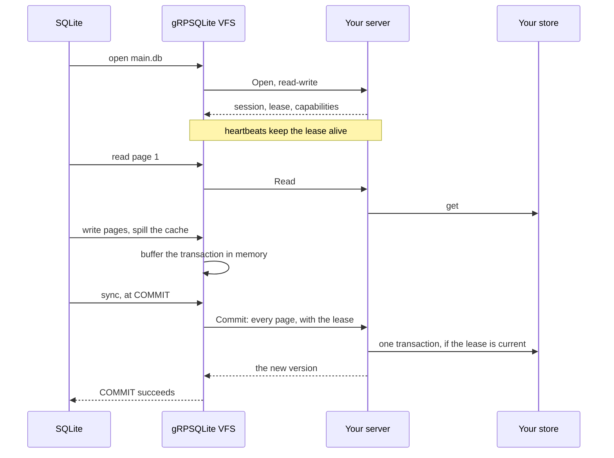

# gRPSQLite

A SQLite VFS that stores databases behind a small gRPC service, so any datastore can hold SQLite databases. Stock SQLite runs on it unchanged, each transaction reaches the server as one atomic commit, and read-only replicas read consistent versions.

Give every user, tenant or agent its own SQLite database, kept in FoundationDB, Postgres, an object store or whatever you already run. Your server stores pages and leases; the VFS handles SQLite's locking, journaling and caching.

> [!WARNING]
> This is early software. A deterministic simulator checks the guarantees below, but gRPSQLite has not run in production.

## Contents

- [What sets it apart](#what-sets-it-apart)
- [Performance](#performance)
- [Quick start](#quick-start)
- [Guarantees](#guarantees)
- [How it works](#how-it-works)
  - [Transactions](#transactions)
  - [Leases](#leases)
  - [Replicas](#replicas)
  - [Page cache](#page-cache)
  - [Servers without atomic commits](#servers-without-atomic-commits)
- [Operator guide](#operator-guide)
  - [Using the VFS](#using-the-vfs)
  - [Configuration](#configuration)
  - [Server capabilities](#server-capabilities)
  - [Writing a server](#writing-a-server)
  - [Tuning](#tuning)
- [Alternatives](#alternatives)
- [Known limits](#known-limits)
- [Development](#development)

## What sets it apart

- **Your storage, stock SQLite.** The server is a plain gRPC service in any language, over any store. SQLite needs no patches: link the VFS in, or load it at runtime. See [Writing a server](#writing-a-server).
- **One request per commit.** The VFS buffers a transaction's pages, including those SQLite spills mid-transaction, and sends them as one `Commit`. A crash at any point leaves the last committed state. See [Transactions](#transactions).
- **Consistent replicas.** On a store that reads as of a version, any number of read-only clients each read one committed version per transaction. See [Replicas](#replicas).
- **Caches that never change an answer.** A writer's cache serves reads without requests while it holds the lease, and survives restarts. A replica's cache follows commits with one `ChangedPages` call. Every cached page is checked against its checksum before use. See [Page cache](#page-cache).
- **Checked by simulation.** A deterministic simulator drives SQLite, the VFS and the reference server through crashes, lost responses, lease takeovers and damaged caches, and checks every answer against a model. 100,000 seeds run in under three minutes. See [Simulator](#simulator).

## Performance

Request counts come from the simulator, so they are exact and repeat run to run. Wall times run over gRPC on loopback with 1 ms added to every response, on one Intel Core Ultra 9 285. The database holds 20,000 rows of 200 bytes in 4 KiB pages, and SQLite caches 50 pages.

| Requests | Writer | Writer, page cache | Replica | Replica, page cache |
|---|--:|--:|--:|--:|
| Insert 20,000 rows in one transaction | 3 | | | |
| 500 point lookups | 478 | 0 | 978 | 500 |
| 50 range scans of 1,000 rows | 398 | 0 | 448 | 50 |
| Full scan | 36 | 0 | 37 | 1 |
| 500 point lookups while a writer commits 50 times | | | 1,245 | 619 |

| Seconds at 1 ms a request | Writer | Writer, page cache | Replica | Replica, page cache |
|---|--:|--:|--:|--:|
| Insert 20,000 rows in one transaction | 0.018 | | | |
| 500 point lookups | 1.041 | 0.001 | 2.122 | 1.077 |
| 50 range scans of 1,000 rows | 0.879 | 0.006 | 0.987 | 0.115 |
| Full scan | 0.087 | 0.002 | 0.088 | 0.005 |

Clients without a page cache start cold. Clients with one run each workload once to warm it.

- **A commit is one request, whatever its size.** The 20,000-row insert sent two commits: one for `CREATE TABLE` and one for the `INSERT`.
- **A writer's cache needs no requests.** While the writer holds the lease, no one else can change the database. After a restart, one header read confirms the whole cache: a full scan took 3 requests instead of 36.
- **Scans read ahead.** Sequential page reads double each fetch, up to 1 MiB. Without read-ahead, the full scan took 1,056 requests and the range scans 2,662.
- **A replica pays one request per read transaction.** It must learn the latest version, so 500 single-row lookups cost at least 500 requests. With a cache, everything else comes from local disk, plus one `ChangedPages` call after each commit.
- **A replica's cache needs `ChangedPages`.** Against a server without it, the cached replica sends as many requests as the uncached one. Each read then carries the cached page's checksum, and the server answers "unchanged" instead of sending the bytes again.
- **Every figure is round trips.** At 1 ms each, 500 lookups take a second. Put the server near its clients.

`cargo run --release -p grpsqlite-sim --bin bench -- --latency-ms 1` reruns both tables.

## Quick start

Linux with Rust, a C compiler, `curl`, `openssl` and `unzip`. Start the in-memory reference server, then build a SQLite 3.54.1 shell with gRPSQLite as its default VFS:

```console
cargo run --release -p grpsqlite-memory &   # listens on 127.0.0.1:50051
scripts/build-sqlite
target/sqlite/sqlite3-grpsqlite main.db
```

```sql
CREATE TABLE users(id INTEGER PRIMARY KEY, name TEXT);
INSERT INTO users(name) VALUES ('Alice'), ('Bob');
SELECT * FROM users;
```

Quit and reopen `main.db`: the rows live on the server. Open it read-only for a replica:

```console
target/sqlite/sqlite3-grpsqlite -readonly main.db 'SELECT count(*) FROM users'
```

`scripts/smoke` runs `examples/*.sql` against servers with and without atomic commits.

## Guarantees

- **Atomic commits.** A transaction reaches the server whole or not at all. A client crash or failure at any point leaves the server at the last committed state. Atomicity is per database: a transaction across attached databases commits each one separately.
- **Durable commits.** `COMMIT` succeeds only after the server acknowledges every page of the transaction. A failed `COMMIT` has an unknown outcome, and the next transaction reads whichever state the server holds.
- **Single writer.** At most one client holds a database's write lease, and the server rejects writes without it. A client that loses its lease stops writing and stops trusting its caches.
- **Consistent replicas.** On a server with point-in-time reads, every read-only transaction reads exactly one committed version.
- **Real SQLite.** Stock SQLite works, linked in or loaded at runtime, with page sizes 512 to 65536, rollback-journal modes, `ATTACH`, and several databases and connections per process.
- **Invisible caches.** Local caching changes latency, never results.

## How it works

SQLite reads and writes its files through a VFS. The gRPSQLite VFS keeps each database's state in one place per process, holds its lease, and turns SQLite's file calls into requests:



Temporary files, statement journals and, on servers with atomic commits, rollback journals stay in client memory. Only the files that must survive a client crash go to the server.

### Transactions

The VFS buffers every write and truncation of the main database from a transaction's first write. Reads inside the transaction see the buffer. At `SQLITE_FCNTL_SYNC`, which SQLite sends at every commit even with `PRAGMA synchronous=OFF`, the VFS sends the buffer as one `Commit`. It discards the buffer when the transaction rolls back, when SQLite drops below a reserved lock, on close, and after an I/O error.

SQLite's own batch-atomic path would do this only in builds with `SQLITE_ENABLE_BATCH_ATOMIC_WRITE`, and it lets cache spills reach the file early. Owning the boundary makes every build atomic.

The lease holder keeps the database header and file size in memory and updates them from its own commits, so a transaction's first read needs no request.

### Leases

A read-write open acquires the database's lease, and a background task heartbeats it. The server checks the lease inside the same transaction that applies a commit. When a heartbeat fails, or none succeeds within the lease's TTL, the VFS fails every operation on the database with `SQLITE_IOERR` and drops its caches until the application reopens it. A reopen acquires the lease again.

Several connections to one database in a process share the lease, and an in-process lock table enforces SQLite's lock levels among them.

### Replicas

A read-only open needs a server with atomic commits and point-in-time reads. Each response carries an opaque version. The first response in a read transaction fixes the version, the VFS sends it with every later read, and SQLite's `unlock` releases it. Each read also returns the file's size at that version, so a transaction needs no separate size request.

SQLite notices commits through the header's change counter, which every commit through an atomic server updates. Exclusive locking mode stops those updates, so the VFS refuses `PRAGMA locking_mode=exclusive` on servers with atomic commits; the lease already makes the client the only writer.

### Page cache

With `GRPSQLITE_CACHE_DIR` and `GRPSQLITE_CACHE_MAX_BYTES` set, each database caches pages on local disk, one file per page, evicting the least recently used.

- **Writer.** While it holds the lease, no other client can change the database, so cached pages need no request, and commits update the cache. At a clean close the cache records the header's change counter. When the database next opens, the first header read either confirms every cached page or empties the cache.
- **Replica.** The cache records the version its pages are current at. When a read transaction starts at a newer version, one `ChangedPages` call lists what changed, the cache drops those pages, and the transaction reads the rest locally. On servers without `ChangedPages`, each read sends the cached page's XXH3-64 checksum and the server answers "unchanged" instead of sending the bytes.

Every page is checked against its checksum before use, so a damaged cache costs a request, never a wrong answer. A lock file keeps two processes from sharing one database's cache; the second runs without one.

### Servers without atomic commits

Without `atomic_commit`, SQLite's own crash recovery protects transactions. The rollback journal or WAL lives on the server, each `Write` applies alone, and after a crash the next writer replays the journal. Use `journal_mode=delete`, `truncate` or `persist`, or WAL with exclusive locking, set before the first read:

```sql
PRAGMA locking_mode=exclusive;
PRAGMA journal_mode=wal;
```

SQLite treats a failed WAL write as one that never happened, yet the frames may have reached the server and completed a commit. After a failed WAL write, the VFS fails every operation until the database reopens, and the reopen rebuilds SQLite's WAL index from the server.

A transaction that writes several attached databases needs a server with atomic commits: SQLite's super-journal would otherwise live in client memory, and a crash would lose it.

## Operator guide

### Using the VFS

The VFS is the `grpsqlite` crate in `crates/vfs`.

**Linked into SQLite.** `cargo build --release -p grpsqlite --features static` builds `target/release/libgrpsqlite.a`. Compile SQLite with `-DSQLITE_EXTRA_INIT=grpsqlite_extra_init` and link the library: SQLite then registers gRPSQLite as its default VFS while it initializes. [`scripts/build-sqlite`](scripts/build-sqlite) does this for the shell.

**Loaded at runtime.** `cargo build --release -p grpsqlite --features dynamic` builds `target/release/libgrpsqlite.so`. Loading it registers gRPSQLite as the default VFS:

```sql
.load target/release/libgrpsqlite
```

**From Rust.** With the `static` feature, `grpsqlite::register_static` registers a `Core` under any name, next to SQLite's own VFSes. `Core` takes any `Backend`; `GrpcBackend` is the gRPC client. `crates/sim/src/harness.rs` shows the pattern with rusqlite.

### Configuration

| Variable | Default | Meaning |
|---|---|---|
| `GRPSQLITE_URL` | `http://localhost:50051` | The server. |
| `GRPSQLITE_CLIENT_TOKEN` | empty | Sent with every `Open`. |
| `GRPSQLITE_CONNECT_TIMEOUT_MS` | `10000` | Connection timeout. |
| `GRPSQLITE_RPC_TIMEOUT_MS` | `30000` | Deadline for each request. |
| `GRPSQLITE_KEEPALIVE_INTERVAL_MS` | `10000` | HTTP/2 keepalive interval. |
| `GRPSQLITE_KEEPALIVE_TIMEOUT_MS` | `20000` | HTTP/2 keepalive timeout. |
| `GRPSQLITE_CACHE_DIR` | unset | Local page cache directory; set with `GRPSQLITE_CACHE_MAX_BYTES`. |
| `GRPSQLITE_CACHE_MAX_BYTES` | unset | Most bytes each open database may cache. |
| `GRPSQLITE_LOG` | `warn` | `off`, `error`, `warn`, `info`, `debug` or `trace`, sent to `sqlite3_log`. |

An invalid setting makes every open fail with `SQLITE_CANTOPEN` and logs the reason; the host process keeps running. The VFS connects on the first open, so a missing server fails that open rather than the process.

### Server capabilities

A server declares what it supports in its `Open` response.

| Capability | Set it when your store can | What clients get |
|---|---|---|
| `atomic_commit` | apply many writes in one transaction: FoundationDB, Postgres, DynamoDB, most databases | One `Commit` per transaction. The server stores only the main file. Every rollback-journal mode works, and `memory` is cheapest; WAL is refused. |
| `point_in_time_reads` | read as of a version: FoundationDB, CockroachDB's `AS OF SYSTEM TIME`, RocksDB with user-defined timestamps, an object store behind a versioned index | Read-only replicas. Needs `atomic_commit`. |
| `changed_pages` | list what changed between two versions | Replica caches that follow commits in one request. |
| none of these | only write bytes: a filesystem, Redis | SQLite's journal or WAL on the server, and its own crash recovery. |

### Writing a server

You are writing a block device with leases. [`proto/grpsqlite.proto`](proto/grpsqlite.proto) is the contract, and [`crates/memory`](crates/memory/src/lib.rs) is the reference implementation that the simulator tests. A server with atomic commits implements `Open`, `Close`, `Heartbeat`, `Read`, `Commit` and `GetFileSize`; `Pragma` and `ChangedPages` are optional.

- **Keys.** SQLite writes the main file in whole pages at page-aligned offsets, so key pages by `offset / page_size`. Reads can be shorter or start mid-page, such as the 100-byte header or the change counter at offset 24; serve them from the page that holds them.
- **Missing data.** Return the bytes that exist; the client zero-fills the rest.
- **Leases.** Check the lease inside the transaction that applies a write or commit. Return `FAILED_PRECONDITION` for a missing, expired or replaced lease.
- **Versions.** With point-in-time reads, return a version with every read and read at the version a request carries. Versions are opaque bytes: a timestamp, a commit hash, a log offset. Return `OUT_OF_RANGE` for one you no longer keep.
- **Sizes.** Set `ReadResponse.size` to the main file's size at the version read, and replicas skip `GetFileSize`.
- **Changed pages.** `ChangedPages` may list more than changed, never less, and must include bytes a change of size added or removed.
- **Message size.** A `Commit` holds a whole transaction, and a `VACUUM` rewrites the whole database. Raise your gRPC server's message limit above the default 4 MiB.

### Tuning

**Disable Nagle's algorithm** on accepted connections. Each request is a small round trip, and Nagle's algorithm with delayed acknowledgments stalled each one by about 36 ms: a `SELECT` over the reference server took 21.7 s before and 0.022 s after.

**Use `journal_mode=memory`** on servers with atomic commits. The journal stays in client memory in every mode, and `memory` skips the work of writing it.

**Size SQLite's cache.** `PRAGMA cache_size` decides how many pages SQLite keeps between transactions. A replica rereads the change counter at the start of each read transaction. When the counter is unchanged, SQLite keeps its pages, so a transaction it can answer from them costs one request.

**Give replicas a page cache.** On a server with `ChangedPages`, it halved the requests of lookups under concurrent commits and made scans nearly free.

## Alternatives

| Option | Choose it when |
|---|---|
| **mvsqlite** | You run FoundationDB and need several concurrent writers per database, with page-level optimistic concurrency. |
| **Graft** | You want lazy, partial replication of SQLite to edge and mobile clients, with its own storage engine and sync protocol. |
| **LiteFS** | You want a FUSE filesystem that replicates SQLite from one primary to read replicas across a cluster. |
| **Litestream** | You want continuous backup of a local SQLite database to object storage, with point-in-time restore. |
| **libSQL and Turso** | You want a fork of SQLite with a server mode, embedded replicas and a hosted service. |
| **rqlite or dqlite** | You want SQLite replicated by Raft across a few nodes you run, and can use their APIs instead of opening files with SQLite. |
| **Cloud Backed SQLite** | Your databases live in Azure Blob Storage or Google Cloud Storage and a block-based VFS from the SQLite project fits. |

The case for gRPSQLite is the storage boundary: a small protocol that puts stock SQLite on a store you already operate and trust, with its transactions, leases and versions.

## Known limits

- **One writer per database.** Concurrent writers wait for the lease; there is no multi-writer mode.
- **Every cache miss is a round trip.** A writer without a page cache pays one request per page SQLite lacks, apart from sequential scans.
- **A failed `COMMIT` has an unknown outcome.** The application learns which state the server holds by reading it.
- **Lease loss needs a reopen.** Operations fail with `SQLITE_IOERR` until the application closes and reopens the database. On servers without atomic commits, exclusive locking mode lets SQLite answer reads from its own page cache without asking the VFS, so a client that lost its lease can read stale pages until a read misses that cache.
- **WAL needs exclusive locking.** WAL with shared memory across processes is unsupported; the WAL lives on a server without atomic commits.
- **Replicas need atomic commits and point-in-time reads.** Stores that cannot read a past version serve no replicas on their own.
- **Transactions are bounded by the server's message limit.** A `Commit` carries the whole transaction in one message.
- **Tested on Linux.** The build script and CI run on Linux.

## Development

[PLAN.md](PLAN.md) is the phased build plan, with evidence for each item.

| Path | What it is |
|---|---|
| `crates/vfs` | The `grpsqlite` VFS: per-database state, transactions, leases, replicas and the page cache, over a `Backend` trait. |
| `crates/proto` | The generated protocol, built with `protox`, so no `protoc` is needed. |
| `crates/memory` | The reference server: a deterministic `Store` with versions and leases, and the `memory-server` binary. |
| `crates/sim` | The simulator (`vopr`), the benchmark (`bench`), the rusqlite harness, and the repro, end-to-end and seed tests. |
| `vendor/sqlite-plugin` | `sqlite-plugin` 0.11.0 with two patches, described in its `PATCHES.md`. |
| `scripts/build-sqlite` | Builds SQLite 3.54.1 shells with the VFS linked in and as a loadable extension. |
| `scripts/smoke` | Runs `examples/*.sql` through the shell against the memory server. |
| `scripts/mutants` | Plants known bugs and checks that the simulator catches each. |

### Testing

```console
cargo test --workspace                      # unit, repro, end-to-end and seed tests
cargo clippy --workspace --all-targets -- -D warnings
scripts/build-sqlite && scripts/smoke       # the SQLite shell against the memory server
scripts/mutants                             # planted bugs the seeds must catch
```

`crates/sim/tests/repro.rs` replays each bug this design fixed, and `crates/sim/tests/e2e.rs` runs the VFS over real gRPC.

### Simulator

A seed fixes the whole run. It draws a server (atomic or not, with or without point-in-time reads and `ChangedPages`), a page size, journal and locking modes, a cache with its damage rates, and fault rates. SQLite, the VFS and the reference server's `Store` then run on one thread in simulated time through random transactions, savepoints, rollbacks, `VACUUM`, reopens, replicas, transactions across attached databases, crashes at any request, lost responses and lease takeovers. Every answer must match a model of the committed rows, every replica transaction must see one committed state, and each step must finish within a request budget. Pass a run's seed back to replay it exactly.

```console
cargo run --release -p grpsqlite-sim --bin vopr -- 0 --seeds 100000   # seeds 0 to 99,999 on every core
cargo run --release -p grpsqlite-sim --bin vopr -- 42 --verbose       # replay seed 42 step by step
```

CI runs 2,000 seeds starting from the commit hash.

### Benchmarks

`cargo run --release -p grpsqlite-sim --bin bench` counts requests per workload against the simulated server. `--latency-ms N` adds wall-time runs over gRPC against an in-process memory server that delays every response by N ms.
